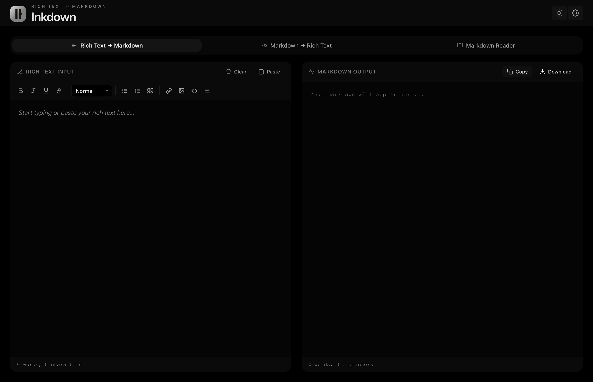

#  Inkdown

A privacy-first rich text and Markdown converter for the browser and macOS.

Convert pasted rich text into clean Markdown, render Markdown back into rich text, or use the reader mode for a focused local preview. No account, no server, no content upload.



## Download

The current macOS build is an unsigned Apple Silicon preview:

- [Download the latest release](https://github.com/aditya-pandya/Inkdown/releases/latest)
- Supported Macs: Apple Silicon only
- Build status: unsigned and not notarized

Because this build is unsigned, macOS may block the first launch. To open it:

1. Download `Inkdown-1.1.0-arm64.dmg`.
2. Open the DMG and move Inkdown to Applications.
3. Control-click or right-click Inkdown, choose Open, then confirm Open.

If macOS still blocks it, open System Settings, go to Privacy & Security, and choose Open Anyway for Inkdown.

## What It Does

- Convert `Rich Text -> Markdown`
- Convert `Markdown -> Rich Text`
- Read Markdown in a focused local reader mode
- Format content with a built-in editor toolbar
- Copy or download the result instantly
- Run fully offline with bundled libraries and local assets

## Browser Version

You can also use Inkdown as a static browser app:

1. Clone or download this repository.
2. Open [index.html](./index.html) in a modern browser.
3. Choose a conversion direction.
4. Paste or type your content.
5. Copy or download the output.

```bash
git clone https://github.com/aditya-pandya/Inkdown.git
cd Inkdown
open index.html
```

## Desktop Development

```bash
npm install
npm start
```

Build the Apple Silicon macOS preview:

```bash
npm run dist:mac
```

The build writes the app, DMG, and ZIP into `dist/`.

## Privacy

Inkdown keeps your content local. The packaged desktop app uses bundled JavaScript, CSS, icons, and syntax-highlighting assets instead of runtime CDN or web font loads.

The app can open normal external links only when you explicitly click them. It does not send editor content to an external service.

## Project Files

- [index.html](./index.html) - app structure
- [styles.css](./styles.css) - styling and themes
- [app.js](./app.js) - editor and conversion logic
- [electron/main.js](./electron/main.js) - macOS desktop shell
- [electron/preload.js](./electron/preload.js) - desktop bridge
- [scripts/after-pack.js](./scripts/after-pack.js) - macOS package metadata cleanup
- [vendor/](./vendor) - bundled runtime libraries
- [assets/inkdown-mark.svg](./assets/inkdown-mark.svg) - primary app mark

## Release Notes

See [v1.1.0 Apple Silicon Preview](./docs/release-notes/v1.1.0.md).

## License

MIT
