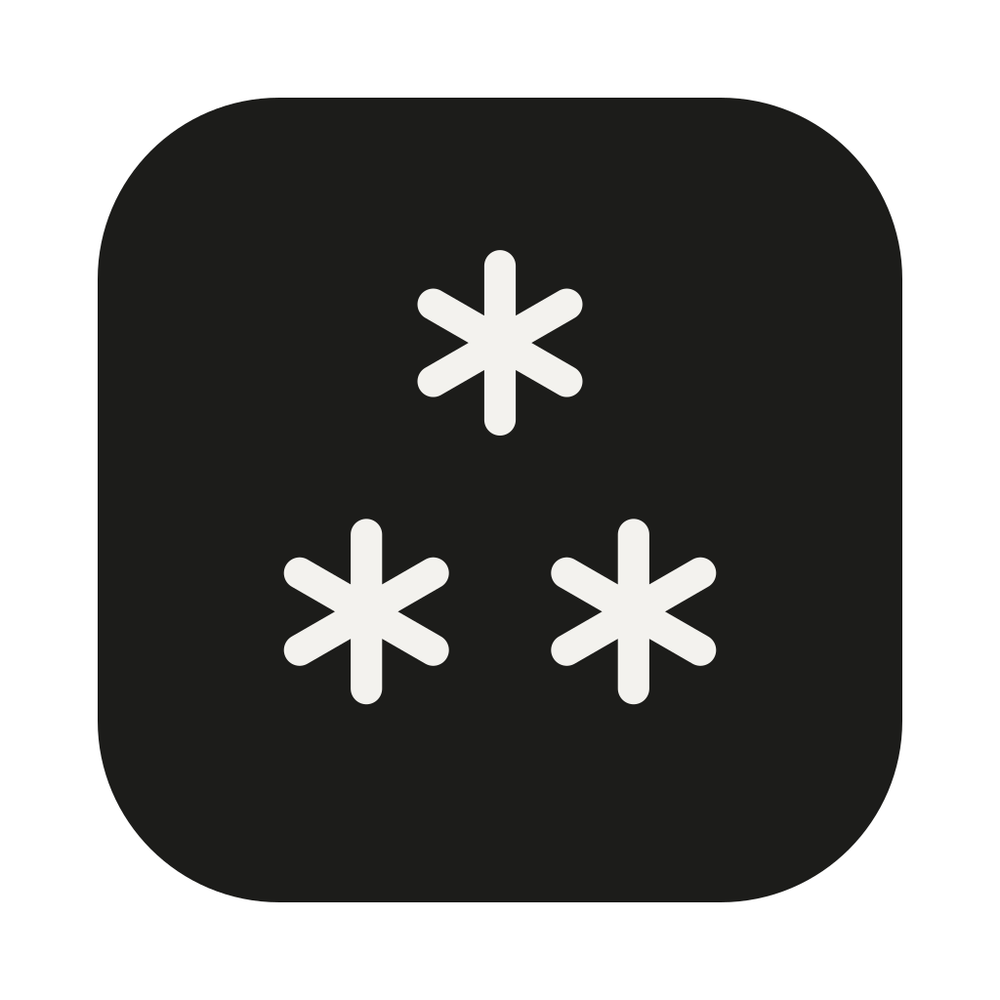
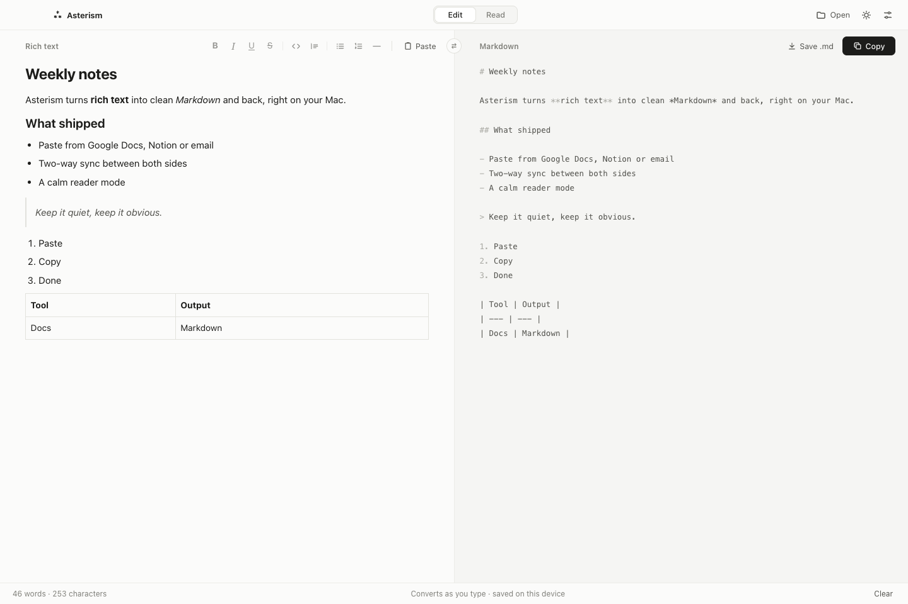

#  Asterism

> Formerly Inkdown. The name comes from ⁂, three asterisks, the punctuation Markdown is built on.

A minimal, local Markdown reader and editor for the browser and macOS.

Open a document to read it, then switch to Edit when you want to change it. The formatted and Markdown panes stay in sync, so you can also turn pasted rich text into clean Markdown. Find works in either view. No account or content upload.



## Download

The current macOS build is an unsigned Apple Silicon preview:

- [Download the latest release](https://github.com/aditya-pandya/asterism/releases/latest)
- Supported Macs: Apple Silicon only
- Build status: unsigned and not notarized

The linked v1.2.0 release predates the find, reader, and file-save improvements described below. Build this checkout from source to try them until a new preview is published.

### Why macOS warns you

Asterism (formerly Inkdown) is a personal open-source project. I do not have a paid Apple Developer certificate, so the macOS app is not signed or notarized. Because of that, macOS Gatekeeper shows a warning the first time you open it. It does this for any app that is not signed and notarized.

The warning means macOS cannot verify the developer identity of this build. Review the source and the checks below before deciding whether to open an unsigned app.

### How to inspect it

You do not have to take my word for it. Here is what you can check yourself:

- The full source code is in this public repository under the MIT license.
- It runs fully offline, with bundled libraries and local assets.
- The page has a strict Content-Security-Policy with `connect-src 'none'`. You can see it in [index.html](./index.html). Remote images can still load, including images in a Markdown file or pasted rich text.
- Recovery drafts stay in this app's local storage. Files you save go to the folder you choose, including a synced folder if you select one. Asterism itself does not upload the document.
- You can skip the download and build it yourself from source with `npm install` and `npm run dist:mac` (see [Desktop Development](#desktop-development)).
- You can also use the [browser version](#browser-version) and avoid the macOS warning entirely.

### How to open it

1. Download `Asterism-1.2.0-arm64.dmg`.
2. Open the DMG and move Asterism to Applications.
3. Control-click or right-click Asterism, choose Open, then confirm Open.

If macOS still blocks it, open System Settings, go to Privacy & Security, and choose Open Anyway for Asterism.

## What It Does

- Open Markdown, text, and HTML files in Read view
- Edit formatted text and Markdown side by side, using one document source
- Find in Read and Edit, with next/previous matches and Markdown replace
- Use one text-size setting across reading and editing
- Save opened Markdown files back to the same file on macOS, or use Save As
- Follow local Markdown links and view nearby images in the macOS app; jump to headings from in-document links
- Convert pasted rich text to Markdown, then copy or save it
- Run fully offline with bundled libraries and local assets

Before the first formatted edit, Asterism checks for common source-only syntax such as HTML comments, link and footnote definitions, and YAML front matter outside fenced code blocks. It offers the Markdown pane or an explicit conversion choice, with the option to restore the original source during that session. This guard catches common cases, but it does not guarantee a lossless Markdown round trip; other syntax may still be rewritten. Use the Markdown pane when exact source matters. Turning Auto-save off stops new recovery snapshots but keeps the last snapshot until you clear saved data in Settings.

On macOS, a recovered draft can offer **Reconnect file**. Choose the same file and Asterism reconnects only when its raw contents still match the saved recovery baseline. If they differ, use Save As to choose a destination. Reconnection is available for recovered Markdown drafts.

## Browser Version

You can also use Asterism as a static browser app:

1. Clone or download this repository.
2. Open [index.html](./index.html) in a modern browser.
3. Open a file, or paste or type your content.
4. Read, edit, find, copy, or download Markdown. Browser saves download a file rather than writing back to the original.

```bash
git clone https://github.com/aditya-pandya/asterism.git
cd asterism
open index.html
```

## Desktop Development

```bash
npm install
npm start
```

Build the Apple Silicon macOS preview:

```bash
npm run dist:mac
```

The build writes the app, DMG, and ZIP into `dist/`.

## Privacy

Asterism keeps your content local. The packaged desktop app uses bundled JavaScript, CSS, icons, and syntax-highlighting assets instead of runtime CDN or web font loads.

The app can open normal external links only when you explicitly click them. It does not send editor content to an external service.

## Project Files

- [index.html](./index.html) - app structure
- [styles.css](./styles.css) - styling and themes
- [app.js](./app.js) - editor and conversion logic
- [electron/main.js](./electron/main.js) - macOS desktop shell
- [electron/preload.js](./electron/preload.js) - desktop bridge
- [scripts/after-pack.js](./scripts/after-pack.js) - macOS package metadata cleanup
- [vendor/](./vendor) - bundled runtime libraries
- [assets/asterism-mark.svg](./assets/asterism-mark.svg) - primary app mark

## Release Notes

See [v1.2.0 Asterism](./docs/release-notes/v1.2.0.md). Older notes: [v1.1.0 Apple Silicon Preview](./docs/release-notes/v1.1.0.md).

The [core product audit](./docs/CORE_AUDIT.md) records the current baseline, competitor references, and remaining gaps.

## License

MIT
